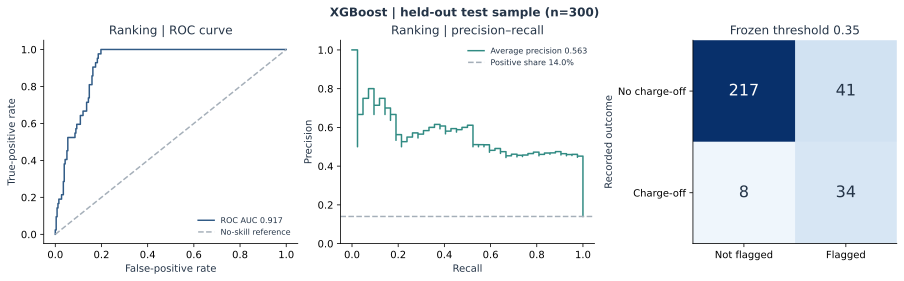
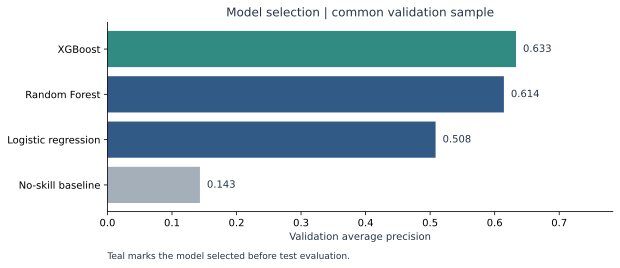

# New-to-Credit Consumer Risk Analysis

**A reproducible Python study of credit-score gaps, model ranking and review-threshold trade-offs.**

Chloe Pham and Grace Ngo · Dickinson College · Original joint project, May 2025

[Research notebook](notebooks/NTC_Consumer_Credit.ipynb) · [Results](reports/summary.md) · [Data dictionary](data/data_dictionary.md) · [Portfolio case](https://graciendx.github.io/case-studies/new-to-credit.html)

## The decision problem

How should an analyst flag credit risk when conventional credit history is limited? The project studies **2,000 credit profiles**, including **830 without a FICO score**, and compares how different models and thresholds balance unnecessary review flags against missed recorded charge-offs.

The original input is available from a pinned public commit in the shared project repository. A checksum-verified local download step keeps the data at its existing source location while making the analysis reproducible. No Google Drive mount or API key is required. The notebook contains executed tables and figures.

## Reproduced findings

The reviewed workflow selects **XGBoost** by validation average precision and freezes its score threshold at **0.35** before evaluating the 300-profile test partition.

| Held-out test measure | Reproduced result |
| --- | --- |
| ROC AUC | **0.917** |
| Average precision | **0.563**, versus **0.140** for the no-skill baseline |
| Precision | **45.3%** |
| Recall | **81.0%**: 34 of 42 positive outcomes identified |
| Flagged profiles | **75 of 300**: a 25.0% review share |
| Error counts | 41 false-positive flags; 8 missed positives |

The result makes the operating trade-off concrete: higher recall still comes with review volume and false-positive flags. These are retrospective research classifications of `Ever_ChargeOff`, not approvals or calibrated future default probabilities.



[Full numerical report](reports/summary.md) · [Test metrics CSV](reports/test_summary.csv) · [Machine-readable evaluation](reports/evaluation.json)

## Run in a clean environment

Python **3.12** is the verified environment. Clone or download this repository, open a terminal in its root folder, then run:

```sh
python -m venv .venv
# macOS / Linux
source .venv/bin/activate
# Windows PowerShell: .venv\Scripts\Activate.ps1
python -m pip install -r requirements.txt
python scripts/reproduce.py
python -m unittest discover -s tests -v
```

The reproduction command downloads and verifies the pinned source locally, then regenerates aggregate data profiles, validation model comparisons, threshold tables, held-out metrics, four SVG figures and an analytical summary in `reports/`. It also prepares the local CSV for the Tableau workbook. No applicant-level model scores or decisions are exported.

For a quick software demonstration on a separate generated toy dataset:

```sh
python -m ntc_risk --demo --output outputs/demo
```

### Open or re-execute the notebook

The [saved notebook](notebooks/NTC_Consumer_Credit.ipynb) can be read directly on GitHub. To regenerate its outputs headlessly:

```sh
python -m pip install -r requirements-notebook.txt
python scripts/execute_notebook.py
```

To work interactively, open the notebook in VS Code or JupyterLab and select the `.venv` Python environment. [Quick start and troubleshooting](docs/quickstart.md) covers Windows activation, installation and kernel selection.

### Open Tableau

After the analysis command, open [`tableau/NTC.twb`](tableau/NTC.twb) in Tableau Desktop. Its relative data connection uses the newly generated `data/tableau_input.csv`. The workbook contains nine worksheets and one dashboard for exploratory reporting of observed outcomes. [Tableau guide](docs/tableau.md)

## Evaluation design

1. **Preserve source coverage.** Retain all 2,000 rows and the missing-score signal.
2. **Define eligible predictors.** Use 23 allowed source fields plus two explicit derived inputs. Exclude outcome-associated balances, the ambiguous prior charge-off field, age and unknown columns.
3. **Separate preparation from evaluation.** Stratify the sample into 1,400 training, 300 validation and 300 test profiles. Fit imputation and logistic scaling on training data only.
4. **Compare meaningful baselines.** Evaluate a no-skill classifier, logistic regression, Random Forest and XGBoost on the same validation sample.
5. **Declare the selection rule.** Select the model by validation average precision. For each candidate, select the threshold with highest validation precision subject to at least 50% recall and 10 flags. These are explicit research constraints.
6. **Freeze and report.** Evaluate only the selected model and the no-skill baseline on test data, using the frozen rule. Publish confusion counts alongside ranking metrics.



[Threshold trade-offs](reports/figures/validation_thresholds.svg) · [Field policy](data/data_dictionary.md) · [Methodological review](docs/methodology_review.md)

## What an employer can inspect

| Material | What it demonstrates |
| --- | --- |
| [`notebooks/NTC_Consumer_Credit.ipynb`](notebooks/NTC_Consumer_Credit.ipynb) | Executed analytical narrative, data audit, comparisons and diagnostics |
| [`ntc_risk/pipeline.py`](ntc_risk/pipeline.py) | Schema checks, feature policy, train-only preprocessing and frozen evaluation |
| [`ntc_risk/reporting.py`](ntc_risk/reporting.py) | Aggregate reporting and consistent research figures |
| [`reports/`](reports/) | Reproduced results ready to inspect before running code |
| [`data/source/`](data/source/) | Local source folder, pinned upstream link and checksum verification |
| [`tests/`](tests/) | Behavioral tests of split separation, exclusions, imputation, reporting and reproduction guards |
| [GitHub Actions](https://github.com/graciendx/New_to_Credit_Consumer_Risk_Analysis/actions) | Automated tests, original-data reproduction and notebook execution |

## Authorship and source

This is a reviewed publication of the **joint project by Chloe Pham and Grace Ngo**. The [original shared repository](https://github.com/chloephammi/New-To-Credit-Consumer) is preserved upstream. The current publication adds a self-contained runtime, explicit feature policy, controlled model selection, original-data reports and automated verification.

[Source map](docs/original_project.md) · [Data provenance](data/README.md) · [Verification record](docs/verification.md)

Original notebook figures remain separately documented as historical evidence. The results above come from the reviewed original-data run. The source supports retrospective educational analysis; technical assumptions and interpretation are documented in the methods.
