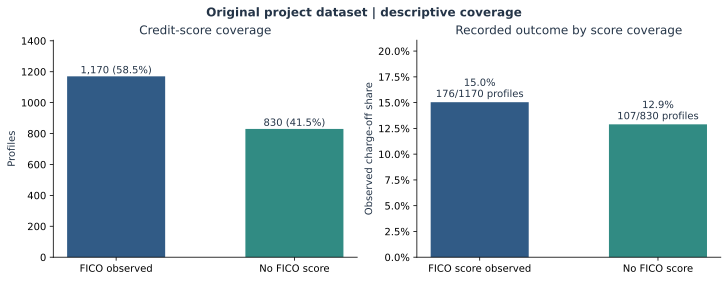
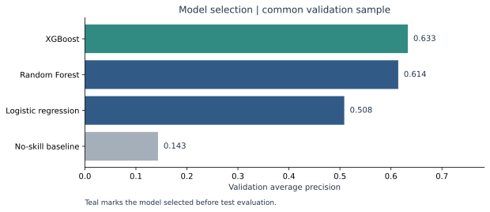
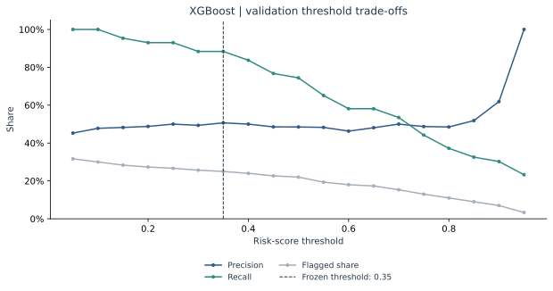
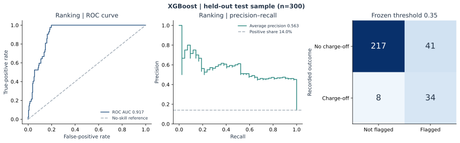

# Reproduced analytical results

Dataset: coursework. Reproduced retrospective evaluation on the original project dataset.

## Data and design

- 2,000 profiles; 283 recorded positive outcomes (14.15%).
- Missing FICO: 830 (41.5%).
- Split sizes: 1,400 train / 300 validation / 300 test.
- Select by validation average precision; choose each model’s threshold by validation precision subject to the declared recall and flag-count constraints.

## Validation comparison

| Model | Average precision | ROC AUC | Threshold | Precision | Recall | Flagged share |
| --- | --- | --- | --- | --- | --- | --- |
| XGBoost | 0.633 | 0.920 | 0.35 | 50.7% | 88.4% | 25.0% |
| Random Forest | 0.614 | 0.932 | 0.65 | 57.9% | 76.7% | 19.0% |
| Logistic regression | 0.508 | 0.919 | 0.85 | 55.2% | 74.4% | 19.3% |
| No-skill baseline | 0.143 | 0.500 | 0.05 | 14.3% | 100.0% | 100.0% |

## Held-out test evaluation

Frozen choice: **XGBoost**, threshold **0.35**.

- Average precision: **0.563** (no-skill baseline: 0.140).
- ROC AUC: **0.917**.
- Flagged **75 of 300** profiles (25.0%).
- Identified **34 of 42** positive outcomes (81.0% recall).
- **45.3% precision**; 41 false-positive flags and 8 missed positives.

The test sample evaluates only the validation-selected model and the no-skill baseline. It is not used to rank or retune the remaining candidates.

## Interpretation

These are retrospective classification results on the project dataset. The positive label is a recorded charge-off; a model flag is an analytical classification, not a credit decision. See the repository methods for feature eligibility and timing assumptions.

## Figures

